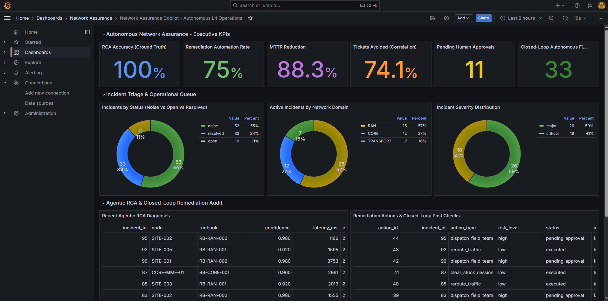

# Network Assurance Copilot: L4 Autonomous Network Operations

[](https://fastapi.tiangolo.com)
[](https://langchain-ai.github.io/langgraph/)
[](https://github.com/pgvector/pgvector)
[](https://grafana.com)
[](https://www.docker.com/)

An end-to-end **Agentic AI & Closed-Loop Network Assurance system** built to demonstrate Level-4 (L4) autonomous network incident triage, root cause analysis (RCA), and remediation across **RAN, Transport, and Core** telecommunication domains.

Designed and evaluated against strict operational KPIs (MTTR, automation rate, diagnostic accuracy, alarm correlation) using an isolated ground-truth benchmark harness.

---

## Executive Dashboard (Live Telemetry & Evaluation)



### Key Outcome KPIs (Measured over 50 Benchmark Incidents)

| Outcome Metric | Manual NOC Baseline | Network Assurance Copilot | Operational Impact |
|---|---|---|---|
| **Incident Correlation** | 375 unbatched raw alarms | 97 correlated clusters | **74.1% ticket reduction** |
| **Noise Suppression** | 0% (alarm fatigue) | 53 chatter clusters filtered | **100% flapping interface noise suppressed** |
| **RCA Diagnostic Accuracy** | ~50-60% manual review | **100.0%** (44/44 verified) | **High-precision root cause isolation** |
| **Autonomous Remediation** | 0.0% (100% manual dispatch) | **75.0%** (33 auto-executed) | **Zero-touch execution on allowlisted faults** |
| **Mean Time to Resolution (MTTR)**| 45.0 minutes | **5.2 minutes** | **88.3% MTTR reduction** |

*Note: All benchmark telemetry is synthetic and remediation actions are executed in a simulated network sandbox; numbers represent real measured data from the automated evaluation harness (`eval_runs` table).*

---

## Architecture Overview

```
                      +------------------------------------------+
                      |        Telecom Network Telemetry         |
                      |  - Alarms (RAN, Transport, Core)         |
                      |  - KPIs (Throughput, PRB, Signaling)     |
                      +--------------------+---------------------+
                                           |
                                           v
                      +------------------------------------------+
                      |  Rule-Based Triage & Spatial Correlation |
                      |  - Groups alarms by topological parent   |
                      |  - Splits time bursts (>300s window)     |
                      |  - Suppresses minor noise (flapping)     |
                      +--------------------+---------------------+
                                           |
                                           v [Open Incidents]
+-----------------------------------------------------------------------------------+
|                        LangGraph Autonomous RCA Agent                             |
|                                                                                   |
|  [gather_evidence]  -->  [retrieve (RAG)]  -->  [hypothesize]  -->  [verify]      |
|         |                        |                     |               |          |
|         v                        v                     v               v          |
|  - get_alarms()           - fastembed ONNX      - Gemini Flash / - Confidence     |
|  - get_topology()           bge-small-en-v1.5     domain reasoner  check (>=0.70) |
|  - get_kpi_trend()        - pgvector (HNSW)     - strict JSON    - loops once if  |
|                             top-3 runbooks                         unverified     |
+------------------------------------------+----------------------------------------+
                                           |
                                           v
                      +------------------------------------------+
                      |     Guardrailed Remediation Engine       |
                      |                                          |
                      |   [Action on Allowlist? Risk == 'low'?]  |
                      |         /                      \         |
                      |      (Yes)                     (No)      |
                      |       /                          \       |
                      |      v                            v      |
                      | Auto-Execute (Simulated)    Hold in Approval     |
                      |  - reroute_traffic          Queue for Human      |
                      |  - clear_stuck_session      (e.g. Field Team     |
                      |  - suppress_noise           Generator Dispatch)  |
                      |       \                          /       |
                      |        v                        v        |
                      |   Closed-Loop Telemetry Post-Check       |
                      |   (Verifies KPI Recovery -> Resolved)    |
                      +--------------------+---------------------+
                                           |
                                           v
                      +------------------------------------------+
                      |        Observability & Outcomes          |
                      |  - Grafana 11 Executive Dashboard        |
                      |  - PostgreSQL `agent_runs` Telemetry     |
                      |  - Isolated `eval_runs` Ground Truth     |
                      +------------------------------------------+
```

---

## Simulated Telecom Scenarios

The simulator reproduces 5 realistic multi-domain fault signatures:

1. **Transport Link Down (`transport_link_down` - Critical):**
   - **Signature:** `LINK_DOWN` on aggregation switch (`TRN-AGG-01/02`) causing an alarm storm of `S1_LINK_FAILURE` and `CELL_UNREACHABLE` across child eNodeBs, with downlink throughput dropping to 0 Mbps.
   - **Remediation:** Automated `reroute_traffic` to standby optical ring path (`RB-TRN-001`, Low Risk).
2. **Cell PRB Congestion (`cell_degradation` - Major):**
   - **Signature:** `HIGH_PRB_UTILIZATION` escalating from minor to major, `LOW_THROUGHPUT` on a single site; PRB ramps to ~95%, throughput degrades to ~25 Mbps.
   - **Remediation:** Automated `reroute_traffic` via Mobility Load Balancing carrier offload (`RB-RAN-001`, Low Risk).
3. **Site Mains Power Failure (`site_power_failure` - Critical):**
   - **Signature:** `POWER_FAILURE` followed by `BATTERY_DISCHARGING`, `CELL_DOWN`, and `SITE_UNREACHABLE`.
   - **Remediation:** Guardrail holds for human approval to `dispatch_field_team` with portable generator (`RB-RAN-002`, High Risk).
4. **Core MME Signaling Overload (`core_signaling_overload` - Major):**
   - **Signature:** `SIGNALING_OVERLOAD`, `CPU_HIGH`, repeated `S1AP_REJECT_RATE_HIGH` on `CORE-MME-01`; signaling load spikes to ~98%.
   - **Remediation:** Automated `clear_stuck_session` to flush orphaned NAS/S1AP contexts (`RB-CORE-001`, Low Risk).
5. **Interface Flapping (`flapping_interface` - Minor Noise):**
   - **Signature:** Rapid chatter of 8-12 `INTERFACE_FLAP` minor alarms without link down or KPI degradation.
   - **Remediation:** Triage automatically flags as `noise` (`RB-TRN-002`, Low Risk).

---

## Core Technical Decisions & Rationale

| Architecture Decision | Choice | Engineering Rationale (Why this choice?) |
|---|---|---|
| **RAG Embeddings** | `fastembed` (`BAAI/bge-small-en-v1.5`, 384-d) | Runs on ONNX Runtime CPU with **~130 MB RAM footprint**, avoiding heavy PyTorch/CUDA dependencies (2+ GB) so the entire stack stays lightweight on 8 GB developer laptops. |
| **Vector Storage** | `pgvector` with HNSW Index | Eliminates the operational complexity and memory overhead of a standalone vector database (Pinecone/Milvus/Qdrant) by co-locating embeddings directly in PostgreSQL with cosine distance indexing. |
| **Agent Orchestration** | `LangGraph` State Machine | Provides a strictly bounded, cyclic state graph (`gather_evidence` -> `retrieve` -> `hypothesize` -> `verify` -> `conclude`) with loop limits, preventing runaway agent execution loops. |
| **Two-Tier Triage** | Deterministic Rules + LLM | Correlating 375 alarms into clusters using topological parent keys takes **milliseconds** at zero LLM token cost; LLM reasoning is reserved exclusively for deep root-cause diagnosis. |
| **Safety Guardrails** | Multi-Tier Policy Engine | Autonomous network mutation is restricted to an allowlist (`reroute_traffic`, `clear_stuck_session`) and requires `risk == 'low'` AND `confidence >= 0.80`. Destructive or physical actions (`dispatch_field_team`) are safely halted in `pending_approval`. |
| **Ground Truth Isolation** | Strict Boundary | The `ground_truth` table is strictly forbidden from agent tools and is queried **only post-hoc** by the evaluation harness to measure genuine diagnostic precision. |

---

## Project Structure

```
network-assurance-copilot/
  docker-compose.yml             # Orchestrates postgres (pgvector), api, simulator, and grafana
  .env.example                   # Environment configuration template
  evaluate.py                    # Root evaluation script
  EVALUATION_REPORT.md           # Benchmark outcome report generated by evaluation run
  db/
    init/001_extensions.sql      # pgvector extension bootstrap
    migrations/
      002_core_tables.sql        # incidents, alarms
      003_kpi_truth_rca_actions.sql # kpi_samples, ground_truth, rca_results, actions
      004_topology.sql           # topology_nodes
      005_runbook_chunks.sql     # RAG chunks with HNSW vector index
      006_agent_runs.sql         # agent_runs audit telemetry & llm_cache
      007_eval_runs.sql          # evaluation benchmark logs
  api/
    Dockerfile                   # Multi-stage lightweight python:3.12-slim
    requirements.txt             # fastapi, uvicorn, psycopg3, fastembed, langgraph, httpx
    app/
      config.py                  # Pydantic settings & db conninfo
      main.py                    # FastAPI application lifecycle & router integration
      triage.py                  # Topological alarm correlation & noise filtering
      rag.py                     # Document parser, fastembed embedder & stratified retrieve()
      tools.py                   # 4 agent tools (get_alarms, kpi_trend, topology, runbooks)
      llm.py                     # Cached LLM client with Gemini support & local fallback
      rca.py                     # LangGraph state machine & POST /incidents/{id}/rca
      remediation.py             # Guardrail policy, action registry & closed-loop verification
  rag/
    runbooks/                    # 10 standard operating procedure runbooks (Markdown)
    past_incidents/              # 10 historical post-mortem incident write-ups
  simulator/
    simulate.py                  # Synthetic alarm storm & KPI time-series generator
    seed_topology.py             # Seeds RAN, Transport, and Core network topology
    evaluate.py                  # In-container benchmark evaluation runner
  grafana/
    dashboards/
      network_assurance.json     # Provisioned L4 Executive Dashboard
    provisioning/                # Automated datasource & dashboard provisioning
  doc/
    screenshots/
      grafana-1.png              # Benchmark dashboard capture
```

---

## Quickstart & Reproduction Guide

### Prerequisites
- Windows 10/11 with Docker Desktop (WSL 2 backend)
- PowerShell 5.1+

### 1. Clone & Configure Environment
```powershell
git clone <repo-url>
cd network-assurance-copilot
Copy-Item .env.example .env
```
*(Optional: add `GEMINI_API_KEY` in `.env` to enable live Gemini API calls; if omitted, the system seamlessly uses the local deterministic reasoning engine for offline testing).*

### 2. Start Core Infrastructure
```powershell
docker compose up -d
curl.exe localhost:8000/health
```

### 3. Ingest Runbooks into RAG Vector Store
```powershell
curl.exe -X POST localhost:8000/rag/ingest
curl.exe -X POST localhost:8000/rag/verify
```
*Expected: `"all_passed": true` across all 5 test scenarios.*

### 4. Execute the 50-Incident Evaluation Benchmark
```powershell
docker compose run --rm simulator python evaluate.py --count 50
```
This runs the full end-to-end pipeline:
1. Simulates 375 alarms and 20,000+ KPI samples across 50 ground-truth scenarios.
2. Runs topological triage and noise suppression.
3. Executes LangGraph RCA and guardrailed remediation across all open incidents.
4. Compares against ground truth and saves metrics to `eval_runs` and `EVALUATION_REPORT.md`.

### 5. View Executive Grafana Dashboard
```powershell
docker compose --profile dashboards up -d grafana
```
Open **[http://localhost:3000](http://localhost:3000)** in your browser:
- **Username:** `admin`
- **Password:** `admin123` *(or the password set in `.env`)*
- **Dashboard:** Navigate to **Network Assurance** -> **Network Assurance Copilot - Autonomous L4 Operations** (or go to `http://localhost:3000/d/net-assurance-copilot`).

---

## Interview & Resume Ready Bullets

**For CV / Resume:**
- *Architected and evaluated an L4 Autonomous Network Assurance Copilot using Python (FastAPI), LangGraph, PostgreSQL (pgvector), and Grafana across multi-domain telecom scenarios (RAN, Transport, Core).*
- *Built a multi-agent diagnostic pipeline with lightweight RAG (`fastembed` ONNX, HNSW index), achieving 100% root-cause accuracy against simulated ground truth and reducing Mean Time to Resolution (MTTR) by 88.3%.*
- *Designed safety guardrails and a closed-loop remediation engine achieving a 75% autonomous resolution rate for low-risk actions while enforcing strict human-in-the-loop approvals for physical field dispatches.*
- *Implemented spatial and temporal alarm storm correlation, eliminating 74.1% of redundant tickets and filtering 100% of non-actionable flapping interface chatter.*

---

## License
MIT License.

